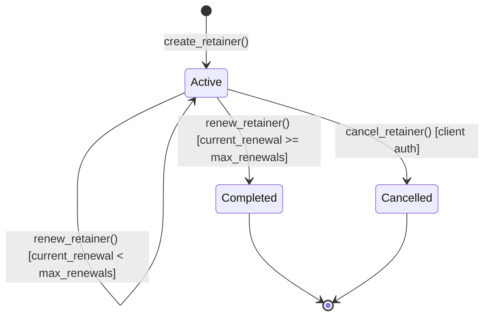

# Retainer Contract Reference

The `contracts/retainer` smart contract implements periodic retainer agreements and cross-chain job escrow interoperability on Stellar Soroban. It provides recurring milestone-based payouts without custodial platform intermediaries, sliding-window rate limiting, trusted-caller bypasses, and cross-chain export/import records.

---

## Architecture & Lifecycle

A retainer is established by a client for a freelancer with an agreed amount per billing interval, defined in ledgers. At each interval, the retainer can be renewed up to `max_renewals`. Once `max_renewals` is reached, the retainer transitions to `Completed`. The client can cancel an active retainer at any time, transitioning it to `Cancelled`.



### Rate Limiting & Security Model

Calls to rate-limited public entrypoints (`create_retainer`, `renew_retainer`, `cancel_retainer`) are evaluated by `enforce_rate_limit`:
1. **Trusted Address Bypass**: If `is_trusted_address(caller)` is `true`, the call proceeds immediately without consuming quota.
2. **Rate Limit Policy**: When `max_calls > 0`, the contract tracks calls made within a sliding time window (`window_seconds`). Exceeding `max_calls` returns `Error::RateLimitExceeded (9)`.
3. **Window Reset**: Once `now - window_started_at >= window_seconds`, the counter resets to 1 and starts a new window.
4. **Administrative Controls**: Admin functions (`export_job`, `import_job`, `set_rate_limit`, `set_trusted_address`) require explicit admin signature via `require_admin`.

---

## Data Structures

### `RetainerStatus` (Enum)
Represents the operational state of a retainer agreement.
- `Active`: Agreement is ongoing and eligible for periodic renewals.
- `Completed`: All allowed renewal periods (`max_renewals`) have been reached and finalized.
- `Cancelled`: Terminated early by the client.

### `Retainer` (Struct)
| Field | Type | Description |
|---|---|---|
| `client` | `Address` | Stellar address of the client funding the retainer. |
| `freelancer` | `Address` | Stellar address of the service provider receiving payments. |
| `amount` | `i128` | Payment amount disbursed per interval. |
| `interval_ledgers` | `u64` | Minimum elapsed time (in ledger timestamp seconds) required between renewals. |
| `max_renewals` | `u32` | Maximum number of renewal payout cycles before contract completion. |
| `current_renewal` | `u32` | Number of successful renewals executed so far. |
| `status` | `RetainerStatus` | Current lifecycle status (`Active`, `Completed`, `Cancelled`). |
| `created_at` | `u64` | Ledger timestamp (Unix seconds) when the retainer was created. |
| `token` | `Address` | Soroban token address used for settlement. |
| `last_renewed_at` | `u64` | Ledger timestamp (Unix seconds) of the most recent renewal (or creation). |

### `CrossChainJob` (Struct)
| Field | Type | Description |
|---|---|---|
| `source_chain` | `String` | Identifier of origin blockchain (e.g., `"stellar"`). |
| `source_job_id` | `u64` | Numerical identifier of the job on the source network. |
| `origin_contract` | `Address` | Contract address on the counterparty or origin chain. |
| `freelancer` | `Address` | Target freelancer address on Stellar. |
| `amount` | `i128` | Escrowed job payout amount. |
| `token` | `Address` | Token contract address on Stellar. |
| `exported` | `bool` | Flag indicating job has been exported across chains. |
| `imported` | `bool` | Flag indicating job has been confirmed/imported on the destination. |

### `RateLimitConfig` (Struct)
| Field | Type | Description |
|---|---|---|
| `max_calls` | `u32` | Maximum invocations allowed per window (0 disables rate limiting). |
| `window_seconds` | `u64` | Length of sliding window in seconds (max 2,592,000 / 30 days). |

### `RateLimitState` (Struct)
| Field | Type | Description |
|---|---|---|
| `window_started_at` | `u64` | Ledger timestamp when the active window began. |
| `calls_in_window` | `u32` | Invocations recorded during current window. |

### `DataKey` (Storage Keys)
- `Admin`: Instance key storing contract administrator `Address`.
- `NativeToken`: Instance key storing default platform token `Address`.
- `RetainerCount`: Instance counter `u64` for generating incremental retainer IDs.
- `CrossChainJobCount`: Instance counter `u64` for generating incremental cross-chain job IDs.
- `RateLimitConfig`: Instance key storing current `RateLimitConfig`.
- `Retainer(u64)`: Persistent key storing `Retainer` records by ID.
- `CrossChainJob(u64)`: Persistent key storing `CrossChainJob` records by ID.
- `RateLimitState(Address)`: Persistent key storing per-address rate limiting state with automatic TTL extension.
- `TrustedAddress(Address)`: Persistent boolean flag identifying rate-limit exempt callers.

---

## Error Codes

| Code | Variant | Description |
|---|---|---|
| `1` | `Unauthorized` | Caller is not authorized to perform the operation (e.g., non-admin or non-client). |
| `2` | `NotFound` | Retainer or cross-chain job record does not exist for the provided ID. |
| `3` | `InvalidStatus` | Operation cannot be performed in the current `RetainerStatus`. |
| `4` | `IntervalNotPassed` | Insufficient time has elapsed since the last renewal (`now < last_renewed_at + interval_ledgers`). |
| `5` | `MaxRenewalsReached` | Retainer has already completed all scheduled renewal cycles. |
| `6` | `AlreadyInitialized` | Contract has already been initialized with an admin. |
| `7` | `NotInitialized` | Contract has not yet been initialized. |
| `8` | `InvalidRateLimitConfig` | Invalid rate limit configuration (both fields must be 0 or >0; max window 30 days). |
| `9` | `RateLimitExceeded` | Invocations in the current window exceeded `max_calls`. |

---

## Public Functions

### 1. `initialize`
Initializes contract state, setting administrator and default platform native token.

```rust
pub fn initialize(env: Env, admin: Address, native_token: Address) -> Result<(), Error>
```
- **Auth**: `admin.require_auth()`
- **Errors**: `Error::AlreadyInitialized`
- **Events**: `("init",)` with data `(admin, native_token)`.

---

### 2. `create_retainer`
Creates and registers a new periodic retainer agreement.

```rust
pub fn create_retainer(
    env: Env,
    client: Address,
    freelancer: Address,
    amount: i128,
    interval_ledgers: u64,
    max_renewals: u32,
    token: Address,
) -> Result<u64, Error>
```
- **Auth**: `client.require_auth()`
- **Rate Limit**: Subject to caller rate limiting.
- **Returns**: `u64` unique retainer identifier.
- **Events**: `("ret_crtd",)` with data `(retainer_id, client, freelancer, amount, max_renewals)`.

---

### 3. `renew_retainer`
Advances the renewal counter when the configured interval has elapsed. If `current_renewal >= max_renewals`, completes the retainer.

```rust
pub fn renew_retainer(env: Env, caller: Address, retainer_id: u64) -> Result<u64, Error>
```
- **Auth**: `caller.require_auth()`
- **Rate Limit**: Subject to caller rate limiting.
- **Errors**: `Error::NotFound`, `Error::InvalidStatus`, `Error::IntervalNotPassed`.
- **Events**:
  - `("ret_rnwd",)` with data `(retainer_id, client, freelancer, amount)` when renewed.
  - `("ret_cmpl",)` with data `(retainer_id, client, freelancer)` when reaching completion.

---

### 4. `cancel_retainer`
Cancels an active retainer agreement.

```rust
pub fn cancel_retainer(env: Env, client: Address, retainer_id: u64) -> Result<(), Error>
```
- **Auth**: `client.require_auth()` (must match `retainer.client`).
- **Rate Limit**: Subject to caller rate limiting.
- **Errors**: `Error::NotFound`, `Error::Unauthorized`, `Error::InvalidStatus`.
- **Events**: `("ret_cncl",)` with data `(retainer_id, client, freelancer)`.

---

### 5. `get_retainer`
Queries stored details of a retainer agreement. Panics if not found.

```rust
pub fn get_retainer(env: Env, retainer_id: u64) -> Retainer
```

---

### 6. `export_job`
Orchestrates outbound cross-chain job registration for bridging between Stellar and an external ledger.

```rust
pub fn export_job(
    env: Env,
    admin: Address,
    source_job_id: u64,
    freelancer: Address,
    amount: i128,
    token: Address,
    target_chain: String,
    target_contract: Address,
) -> Result<u64, Error>
```
- **Auth**: `admin.require_auth()` via `require_admin`.
- **Returns**: `u64` cross-chain job ID.
- **Events**: `("j_xport",)` with data `(cc_id, source_job_id, freelancer, amount, target_chain)`.

---

### 7. `import_job`
Confirms an incoming cross-chain job on Stellar.

```rust
pub fn import_job(
    env: Env,
    admin: Address,
    cross_chain_id: u64,
    source_chain: String,
    source_job_id: u64,
    freelancer: Address,
    amount: i128,
    token: Address,
) -> Result<u64, Error>
```
- **Auth**: `admin.require_auth()` via `require_admin`.
- **Errors**: `Error::NotFound`.
- **Events**: `("j_import",)` with data `(cross_chain_id, source_chain, source_job_id, freelancer, amount)`.

---

### 8. `get_cross_chain_job`
Fetches cross-chain job record by its identifier. Panics if not found.

```rust
pub fn get_cross_chain_job(env: Env, cross_chain_id: u64) -> CrossChainJob
```

---

### 9. `set_rate_limit`
Configures or disables sliding-window rate limiting.

```rust
pub fn set_rate_limit(
    env: Env,
    admin: Address,
    max_calls: u32,
    window_seconds: u64,
) -> Result<(), Error>
```
- **Auth**: `admin.require_auth()`.
- **Errors**: `Error::InvalidRateLimitConfig` (if one parameter is 0 while the other is non-zero, or window > 30 days).
- **Events**: `("rl_cfg",)` with data `(max_calls, window_seconds)`.

---

### 10. `get_rate_limit`
Returns active `RateLimitConfig`.

```rust
pub fn get_rate_limit(env: Env) -> RateLimitConfig
```

---

### 11. `set_trusted_address`
Adds or removes an address from the rate-limit exemption whitelist.

```rust
pub fn set_trusted_address(
    env: Env,
    admin: Address,
    address: Address,
    trusted: bool,
) -> Result<(), Error>
```
- **Auth**: `admin.require_auth()`.
- **Events**: `("trusted",)` with data `(address, trusted)`.

---

### 12. `is_trusted_address`
Checks whether a given address is trusted and exempt from rate limiting.

```rust
pub fn is_trusted_address(env: Env, address: Address) -> bool
```

---

## Build, Test, and Deployment

### Building
Build the contract WASM using Soroban CLI:

```bash
cd contracts/retainer
soroban contract build
```

The resulting optimized WASM binary will be generated in `target/wasm32-unknown-unknown/release/stellarwork_retainer.wasm`.

### Testing
Execute unit tests covering retainer lifecycle, rate limits, and cross-chain tracking:

```bash
cargo test --manifest-path contracts/retainer/Cargo.toml
```

### Deploying to Stellar Testnet
Deploy and initialize using `soroban` CLI:

```bash
# Deploy bytecode
WASM_ID=$(soroban contract install --wasm target/wasm32-unknown-unknown/release/stellarwork_retainer.wasm --network testnet --source admin)

# Instantiate contract
CONTRACT_ID=$(soroban contract deploy --wasm-hash $WASM_ID --network testnet --source admin)

# Initialize
soroban contract invoke \
  --id $CONTRACT_ID \
  --network testnet \
  --source admin \
  -- initialize \
  --admin <ADMIN_ADDRESS> \
  --native_token <NATIVE_TOKEN_ADDRESS>
```
